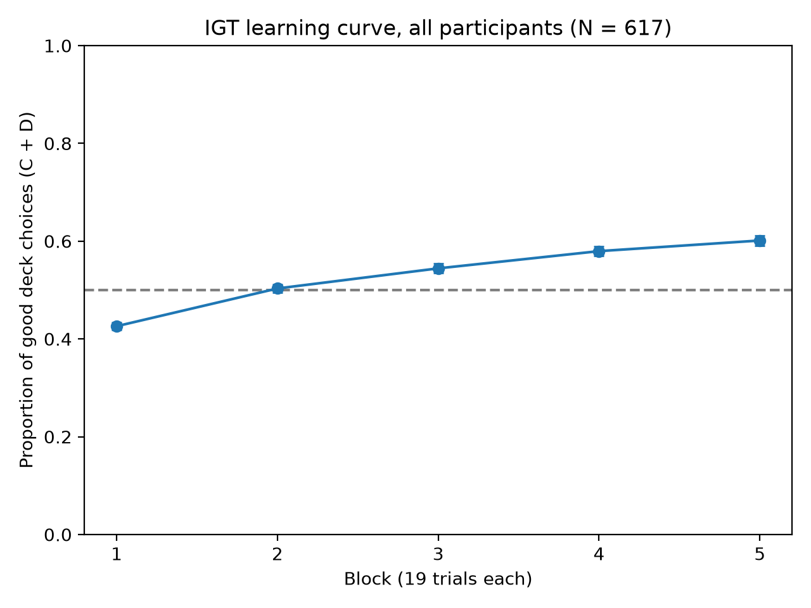

# IGT reanalysis

Reanalysis of open Iowa Gambling Task (IGT) data from 617 healthy participants across 10 studies, in Python. The question: do people learn to choose the advantageous decks over the course of the task, and does that differ by payoff scheme?

## Data

Steingroever, H., et al. (2015). Data from 617 healthy participants performing the Iowa gambling task: A "many labs" collaboration. *Journal of Open Psychology Data, 3*, e5. https://doi.org/10.5334/jopd.ak

The data are available at https://osf.io/8t7rm (CC BY-SA 4.0). They are not included in this repository. Download `IGTdataSteingroever2014.zip` and copy the 12 `.csv` files into a folder called `data/`.

## How to run

```
python3 -m venv .venv
source .venv/bin/activate
pip install -r requirements.txt
python scripts/01_explore.py
python scripts/02_learning_curves.py
python scripts/03_stats.py
```

## Method

- All participants were trimmed to their first 95 trials, so the three trial-count groups (95, 100, 150) could be analysed together.
- Trials were split into 5 blocks of 19. For each participant and block, I calculated the proportion of choices from the good decks (C and D).
- Studies were assigned to payoff schemes 1 to 3 using Table 1 of the data paper.
- Tests: paired t-test (block 5 vs block 1), one-sample t-test (block 5 vs chance, 50%), one-way ANOVA across payoff schemes with Tukey post-hoc comparisons. Because participants are nested in 10 studies, I then fitted linear mixed models with a random intercept for study (`scripts/04_mixed_models.py`).

## Results



- Good-deck choices rose from 43% in block 1 to 60% in block 5, t(616) = 14.28, p < .001, dz = 0.57, and block 5 was above chance, t(616) = 9.86, p < .001. These tests treat all 617 participants as independent.
- In a mixed model with a random intercept for study, the average gain from block 1 to block 5 was 20.4 percentage points, 95% CI [14.6, 26.2], p < .001. Learning holds up when studies are taken into account.
- Payoff scheme looked related to block 5 performance in a one-way ANOVA, F(2, 614) = 3.48, p = .03 (scheme 1 vs scheme 2: p = .028). In the mixed model with study as a random effect, this disappeared: scheme 2 vs scheme 1, -6.8 points, 95% CI [-17.5, 3.8], p = .21; scheme 3 vs scheme 1, -1.6 points, 95% CI [-13.4, 10.2], p = .79. The intervals are wide, so the data cannot say whether scheme matters.
- About 5% of the variance in block 5 scores lay between studies (ICC = .049).

## Limitations

- Studies differ in more than payoff scheme (incentives, instructions, age range), so the scheme comparison is confounded.
- Scheme is a study-level variable and there are only 10 studies (3, 4 and 3 per scheme), so the scheme comparison has little statistical power.
- The mixed models gave boundary convergence warnings. The estimated between-study variance was close to zero, so the models are close to a simple regression, and the random-effects estimates should be read with caution.
- Only the first 95 trials of each participant were used, so later trials in the 100- and 150-trial studies are not analysed.